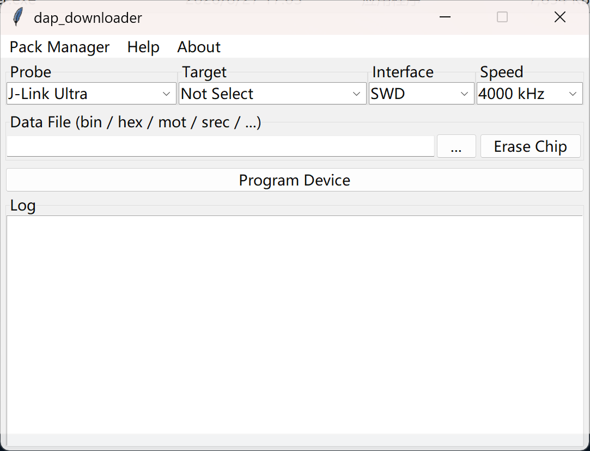
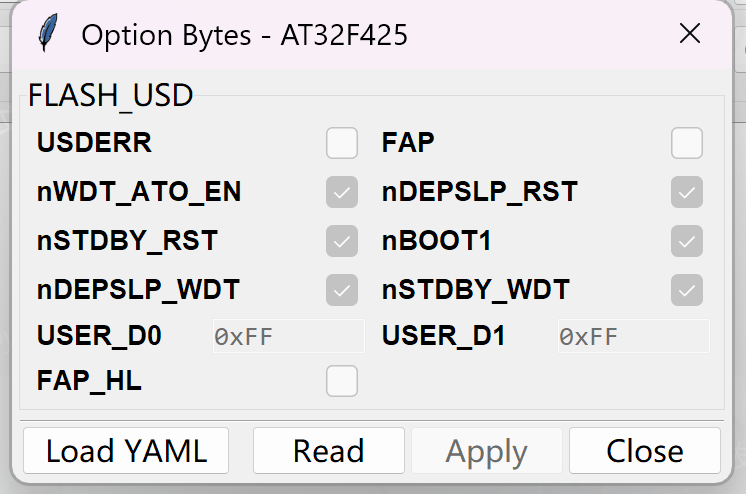
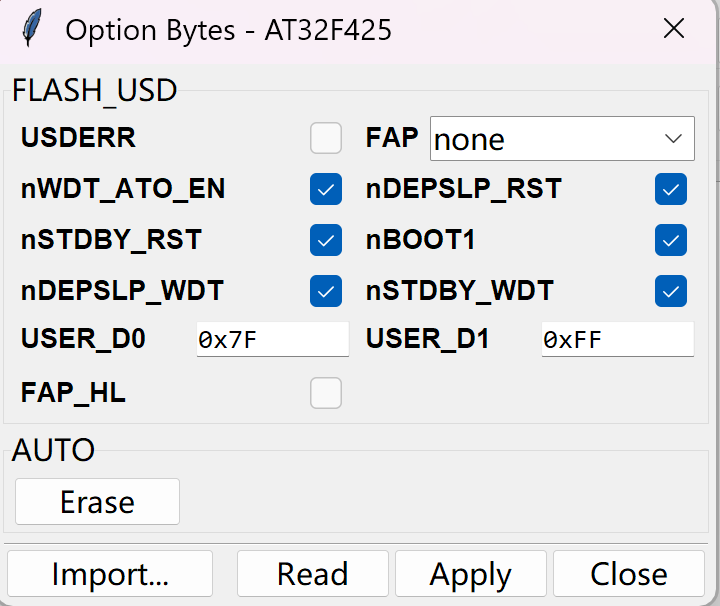

# dap_downloader

<div align="center">

A visual MCU flash tool based on Tkinter + pyOCD

[中文](./README.md) | **English**

<br>



</div>

## Thanks

- **[pyOCD](https://github.com/pyocd/pyOCD)**: an open-source MCU debug and download library that supports most chips.
- **[pygubu](https://github.com/alejandroautalan/pygubu)**: an easy-to-use Tkinter GUI designer (no longer used in this project). Our gratitude goes to it for helping beginners in the pre-AI era.
- **[DeepSeek](https://www.deepseek.com/)**: the AI assistant used during development.

## Features

- Supports pyOCD-supported debuggers
- Built-in algorithms + self-installed CMSIS-Pack chips
- SWD / JTAG with adjustable frequency
- bin / hex / elf / srec firmware, full-chip erase
- Built-in Pack manager
- Option bytes read/write (YAML descriptors)
- Drag & drop support

## Usage

```cmd
python -m venv venv
venv\Scripts\activate
pip install -r packaging\requirements.txt
```

```cmd
python src\dap_downloader.py
```

Package (directory mode):

```cmd
pyinstaller packaging\dap_downloader.spec
```

**Flash**: pick probe → pick chip → pick firmware (set address for bin) → pick interface & speed → Program Device.

**Erase**: pick chip → Erase Chip → confirm.

Pack management and drag & drop are handled in the GUI.

## Option Bytes

Some chips expose option-byte registers through the pack SVD; they are read and written with a YAML descriptor placed in `option_bytes/`.

| State | Description |
| --- | --- |
| No descriptor | All option-byte fields are shown, but read-only |
| Descriptor imported | Fields implemented by the YAML (with a `program` fragment) become editable; the rest stay read-only |
| AUTO actions | Fixed operations declared in the `auto` section (e.g. Erase) appear as buttons and run on click |

<div>


</div>

Descriptors live in the `option_bytes/` folder next to the executable and are matched by `from_pack` + `device`; the filename is arbitrary. See [examples/option_bytes/at32f425.yaml](examples/option_bytes/at32f425.yaml); the format reference and adding-a-new-chip steps are in [examples/option_bytes/README.en.md](examples/option_bytes/README.en.md). The **Import...** button loads and copies a descriptor into `option_bytes/` (or drag a `.yaml` onto the main window to Import); on first open without a descriptor, a skeleton is generated from the current chip SVD and shown in the window hint.

> Keep the J-Link driver at ≤ 9.12.
